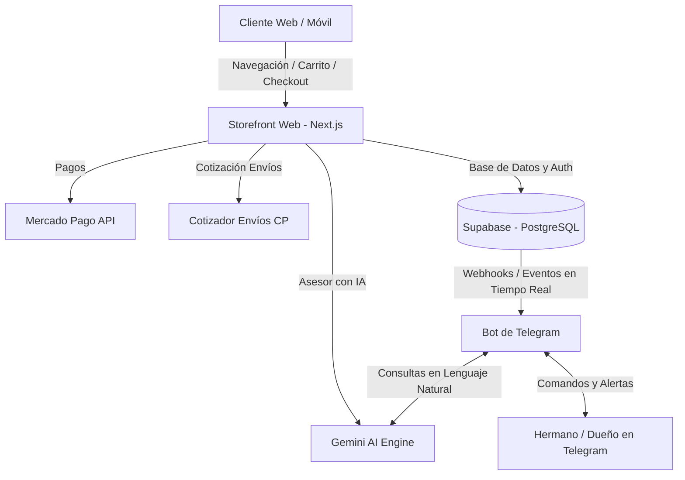

# 🛏️ Proyecto: Tienda Online de Almohadas Viscoelásticas (Argentina)

## 📌 1. Visión del Negocio
Tienda online de alto rendimiento enfocada en la venta de **almohadas viscoelásticas y productos de descanso** con envíos a toda la Argentina. Diseñada para maximizar la conversión con una experiencia de compra ultra simple, asesoramiento interactivo con IA y un copiloto en Telegram que permite al dueño gestionar pedidos, envíos y stock desde su teléfono.

---

## 🎯 2. Particularidades del Nicho y Mercado (Argentina)

### A. Productos y Estrategia de Venta
- **Tipos de Almohadas**:
  - Ergonómica / Cervical (alivio de dolor de cuello/columna).
  - Tradicional / Clásica (sensación de nube, soporte adaptable).
  - Con Gel Refrigerante (para calores o personas con temperatura corporal alta).
  - Talles / Tamaños (Standard 60x40, King 70x40, Packs de 2 y 4 unidades).
- **Upselling & Packs**: Muy alto impacto de venta por pares (*Pack x 2* con descuento o envío gratis).
- **Funda extra / Accesorios**: Fundas lavables con cierre, protectores impermeables, antifaces.

### B. Pagos en Argentina
- **Mercado Pago**:
  - Tarjetas de crédito/débito.
  - Cuotas simples o cuotas sin interés.
  - Dinero en cuenta de Mercado Pago.
- **Transferencia Bancaria (CBU/CVU / Alias)**:
  - Descuento promocional incentivo (ej: 10% o 15% OFF).
  - Carga de comprobante con validación inteligente / confirmación en Telegram.

### C. Envíos y Logística Nacional
- **Logística Nacional**:
  - Correo Argentino / Andreani / OCA / Shipnow.
  - Cotización en tiempo real ingresando el **Código Postal (CP)**.
  - Opción de envío a domicilio o retiro en sucursal del correo (más económico).
- **Envíos Express (AMBA / Local)**:
  - Motomensajería en el día / 24 hs para CABA y GBA o ciudad base.
- **Peso Volumétrico**: Las almohadas ocupan volumen; el cotizador debe contemplar dimensiones empaquetadas (o considerar envíos al vacío si aplica).

---

## 🤖 3. Ecosistema de Inteligencia Artificial

### 1. En la Tienda (Para el Cliente) - "Asesor de Descanso Virtual"
- **Test / Recomendador interactivo**: *"¿Cómo duermes? (boca arriba, de costado, boca abajo) ¿Tienes dolor de cervicales?"* -> La IA recomienda la almohada exacta en 3 preguntas.
- **Chatbot Asistente**: Resuelve preguntas frecuentes al instante:
  - Medidas exactas y densidad de la espuma.
  - Tiempo estimado de entrega ingresando su código postal.
  - Si viene con funda lavable, políticas de garantía y cambios.

### 2. En Telegram (Para el Dueño / Hermano) - "Copiloto Operativo"
- **Alertas inmediatas**:
  - 📦 *¡Nueva compra #1024!*
    - Cliente: María Gómez (Córdoba Capital, CP 5000).
    - Producto: Pack x2 Cervicales Gel.
    - Pago: Mercado Pago ($48.000).
    - Envío: Andreani a Domicilio.
- **Gestión por voz o texto**:
  - *"Che bot, llegaron 40 almohadas cervicales al depósito"* -> Suma 40 al stock.
  - *"¿Cuántos pedidos hay para despachar hoy?"* -> Lista con datos de envío y botón para imprimir/generar rótulos.
  - *"Pausá las de gel que no hay stock hasta el viernes"* -> Oculta o muestra "Sin stock" en la web.
- **Validación de transferencias**: Si el cliente sube comprobante, la IA le muestra la foto en Telegram: *“¿Aprobás el comprobante de $35.000 de Pedro Pérez?”* con botones [Aprobar y despachar] o [Rechazar].

---

## 🏗️ 4. Arquitectura de Software Recomendada



- **Frontend**: Next.js (App Router, Tailwind CSS, diseño moderno, rápido para celular).
- **Base de Datos & Auth**: Supabase (PostgreSQL, almacenamiento de fotos, triggers en tiempo real).
- **Bot de Telegram**: Node.js (GrammY) desplegado en servicio 24/7 (Railway / Render / VPS).
- **Motor IA**: Google Gemini 1.5 Flash / 2.0 Flash (ultrarrápido, económico y con soporte para leer comprobantes y responder preguntas de clientes).
- **Hosting Web**: Vercel o Netlify (nivel gratuito amplio y despliegue continuo).

---

## 📂 5. Estructura de Carpetas Propuesta

```text
Marcos/
├── PROYECTO_ESPECIFICACIONES.md    # Este documento
├── docs/                           # Guías, credenciales necesarias, flujos
│   ├── envios_argentina.md
│   ├── pagos_mercadopago.md
│   └── telegram_bot_setup.md
├── database/                       # Esquemas SQL, migraciones y seed data
│   └── schema.sql
├── storefront/                     # Código de la tienda online (Next.js)
│   ├── src/
│   │   ├── app/                    # Rutas (catálogo, producto, carrito, checkout)
│   │   ├── components/             # UI, buscador, asesor IA, carrito
│   │   └── lib/                    # Supabase client, Mercado Pago, envíos
└── telegram-bot/                   # Bot de control para el dueño
    ├── src/
    │   ├── bot.js                  # Lógica del bot y comandos
    │   ├── ai-agent.js             # Integración con Gemini
    │   └── services/               # Conexión con Supabase y alertas
```
